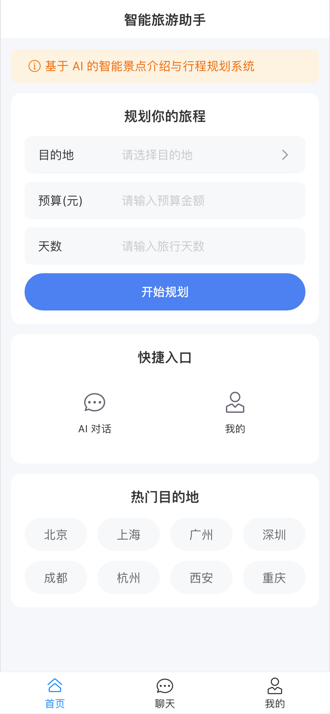
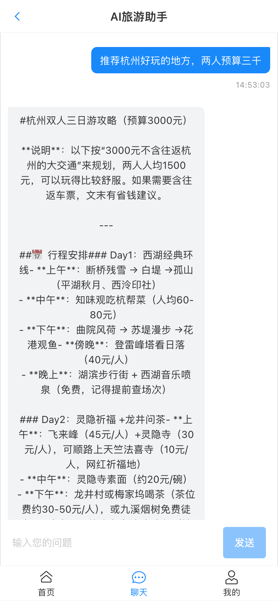
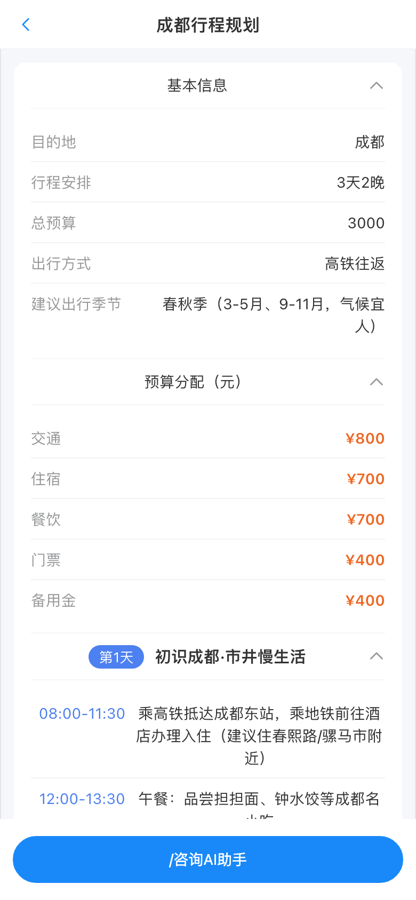

# 智游 AI 旅游助手

基于 **Vue 3 + Express + LangChain** 的智能旅游助手 H5 应用，支持 **AI 流式对话**（打字机效果）、**AI 行程规划** 与景点推荐，前后端分离，移动端优先。

<p align="center">
  
  
  
</p>

## 功能特性

- **AI 流式对话**：基于 **SSE（Server-Sent Events）** 的打字机逐字输出，支持"思考中" loading、消息气泡、多轮问答、自动滚动跟随
- **AI 行程规划**：输入预算 / 天数 / 目的地，LLM 生成结构化 JSON 行程计划，前端解析渲染
- **景点推荐首页**：热门景点浏览、快捷入口
- **工程化细节**：接口分层（routes → services → utils）、环境变量切换模型提供商、SSE 异常兜底、前后端字段约定校验

## 技术栈

| 端 | 技术 |
| --- | --- |
| 前端 | Vue 3（组合式 API）、Vite、TypeScript、Vant 4、Vue Router、Axios |
| 后端 | Node.js、Express、LangChain（@langchain/openai）、SSE、dotenv |
| 大模型 | 火山方舟（豆包）/ DeepSeek，可通过环境变量切换 |

## 项目结构

```
project1
├── travel-h5/                      # 前端 H5
│   └── src
│       ├── components/ChatBubble.vue   # 聊天气泡组件（含"思考中"loading）
│       ├── views/                      # Home / Chat / Plan / Profile
│       ├── router/                     # 路由配置
│       ├── utils/request.js            # axios 封装 + fetchStream SSE 流式读取
│       └── App.vue                     # 底部 Tabbar（路由驱动高亮）
└── travel_server/                  # 后端服务
    └── src
        ├── index.js                     # 入口：CORS、JSON 解析、路由挂载
        ├── routes/travel.js             # /chat（SSE 流式）、/recommend
        ├── services/travelService.js    # 业务规则 + LangChain 流式调用
        └── utils/createStream.js        # SSE 响应工具（send / complete / end / error）
```

## 快速开始

### 环境要求

- Node.js >= 18

### 1. 启动后端

```bash
cd travel_server
npm install
cp .env.example .env        # 填入你的 API Key
npm run dev                 # 默认 http://localhost:3400
```

### 2. 启动前端

```bash
cd travel-h5
npm install
npm run dev                 # 默认 http://localhost:5173
```

## 环境变量

| 变量 | 说明 |
| --- | --- |
| `PORT` | 后端服务端口 |
| `MODEL_PROVIDER` | 模型提供商：`ark` / `deepseek` |
| `ARK_API_KEY` / `ARK_BASE_URL` / `ARK_MODEL` | 火山方舟配置 |
| `DEEPSEEK_API_KEY` / `DEEPSEEK_BASE_URL` / `DEEPSEEK_MODEL` | DeepSeek 配置 |

## 接口说明

### POST /api/travel/chat（SSE 流式）

```bash
curl -N -X POST http://localhost:3400/api/travel/chat \
  -H "Content-Type: application/json" \
  -d '{"message": "杭州一日游怎么安排"}'
```

响应（`text/event-stream`）：

```
data: {"type":"chunk","message":"好"}          # 增量文本，多次推送
data: {"type":"complete","data":{"success":true,"message":"完整回复"}}  # 结束信号 + 全文
```

### POST /api/travel/recommend

```json
// 请求
{ "budget": 3000, "days": 3, "destination": "成都" }
// 响应：LLM 输出的结构化 JSON（服务端解析代码块后返回对象）
```

## 实现要点

- **流式链路**：LLM streaming → service 层 `streamCallback` 回调 → 路由层 SSE 推送 → 前端 `fetch` + `ReadableStream` 逐块解码解析，全程不等待完整响应
- **分层设计**：路由层只做协议与格式校验，业务规则下沉 service 层，可脱离 HTTP 复用
- **事件约定**：SSE 消息携带 `type` 字段区分 `chunk`（增量）与 `complete`（终态），前端据此驱动打字机与状态复位
